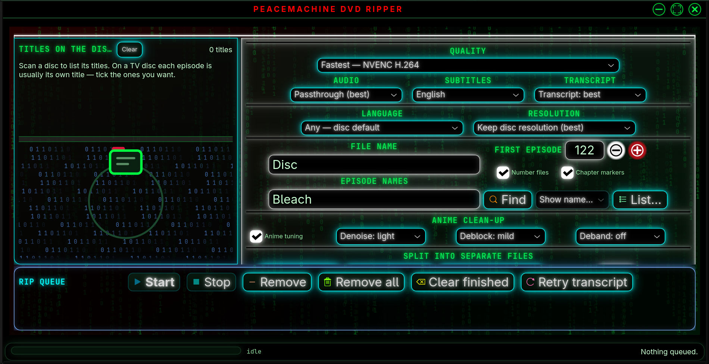
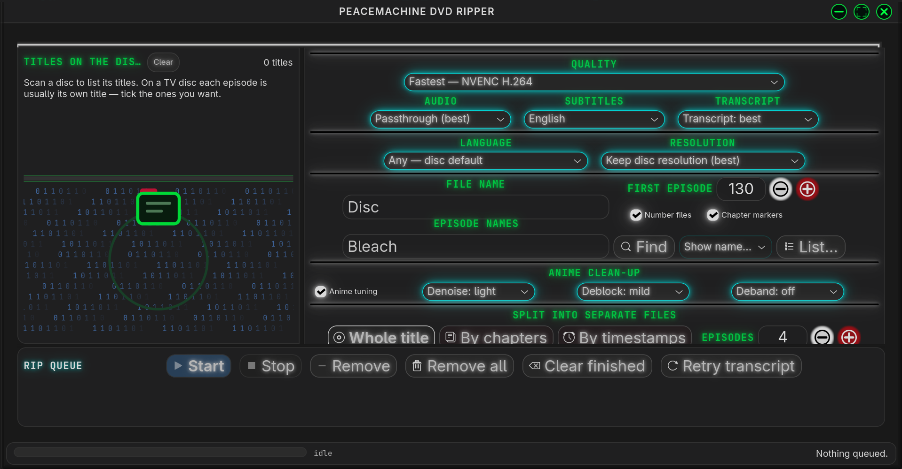

# PeaceMachine DVD Ripper



Rips a DVD — or any video file — into files your PC can play, with optional
per-episode naming in the style of FileBot.

It scans a disc, lists every title with resolution, duration and an estimate,
then queues encodes through HandBrake. Split modes cover whole titles, chapter
ranges and timestamps; there is also a lossless `-c copy` split for existing
video files, and an optional speech-to-text pass (see [Transcripts](#transcripts-optional)).

It installs a launcher (`peacemachine-dvd-ripper`), a menu entry, and keeps your
settings in `~/.local/state/peacemachine-dvd-ripper`.

## Two themes

The Matrix skin is the default. **Basic (dark)** is a neutral theme for a plain
desktop, and it turns off the animated rain, so it is the one to use in a virtual
machine or on a slow laptop. Switch between them from **Theme selector** in the
source row.

| Matrix | Basic (dark) |
| --- | --- |
|  |  |

## Verified builds

Each distribution below is pinned to the version that was actually installed and
run on it, not simply the newest upload.

| Distribution | GTK | Verified at | What was proven |
| --- | --- | --- | --- |
| Debian 12 (bookworm) | 4.8 | 1.0.40 | install, drive detection, scan, Find, Start, Stop, rip |
| Debian 13 (trixie) | 4.18 | 1.0.26 | install, drive detection, scan, rip |
| Ubuntu 22.04 LTS | 4.6 | 1.0.44 | install, Browse and SAVE TO pick a file and a folder, drive detection, scan, rip, transcripts end to end, theme switch, no duplicate window button |
| Ubuntu 24.04 LTS | 4.14 | 1.0.37 | install, drive detection, scan, rip |
| Ubuntu 26.04 | 4.20 | 1.0.26 | install, drive detection, scan, rip, Stop |
| Fedora 45 | 4.20 | 1.0.26 | install (RPM Fusion + `--allowerasing ffmpeg`), scan, rip |
| AlmaLinux 10 | 4.18 | 1.0.37 | install, Flatpak HandBrake, scan, rip, Stop |
| openSUSE Leap 16 | 4.18 | 1.0.37 | install, Flatpak HandBrake, scan, rip |
| Kali, Mint, Pop!_OS | - | - | same apt path as the Ubuntu builds above |
| Arch / Omarchy | 4.20 | 1.0.37 | package installs clean; the author runs the same code |

Transcripts were proven end to end on Ubuntu 22.04 at 1.0.44: `--install-asr`
built the engine, the model downloaded, and the rip finished with subtitles beside
it.

**1.0.44 is the current build for every distribution**, and is what the install
blocks below fetch. The table records the version each distribution was actually
tested at.

## Install

**Run one command at a time.** Paste a single line, let it finish, then the next —
running several at once is how you end up not knowing which one failed.

Everything below installs **PeaceMachine DVD Ripper 1.0.44**. The application is
the same on every distribution; only the package names differ.

### Arch, Omarchy, Manjaro, EndeavourOS, CachyOS

1. The tools HandBrake needs — all three are in `extra`:

```
sudo pacman -S handbrake-cli ffmpeg libdvdcss
```

2. The ripper:

```
sudo pacman -U https://github.com/C0D3DSK1LLS/peacemachine-dvd-ripper/releases/download/v1.0.44/peacemachine-dvd-ripper-1.0.44-1-any.pkg.tar.zst
```

3. Launch it:

```
peacemachine-dvd-ripper
```

4. Optional — subtitles transcribed from the dub, skippable. The engine is a
   separate download (see [Transcripts](#transcripts-optional)):

```
peacemachine-dvd-ripper --install-asr
```

### Debian

Verified on Debian 12 (GTK 4.8) and Debian 13.

1. HandBrake, ffmpeg and curl:

```
sudo apt install -y handbrake-cli ffmpeg curl
```

2. `libdvdcss`, which Debian will not ship — `libdvd-pkg` builds it locally, and
   it lives in the **contrib** section:

```
sudo sed -i 's/ main$/ main contrib/' /etc/apt/sources.list
```

```
sudo apt update
```

```
sudo apt install -y libdvd-pkg
```

```
sudo dpkg-reconfigure libdvd-pkg
```

3. The ripper:

```
curl -LO https://github.com/C0D3DSK1LLS/peacemachine-dvd-ripper/releases/download/v1.0.44/peacemachine-dvd-ripper_1.0.44_all.deb
```

```
sudo apt install ./peacemachine-dvd-ripper_1.0.44_all.deb
```

4. Launch it:

```
peacemachine-dvd-ripper
```

5. Optional — subtitles transcribed from the dub. Debian ships Python's venv
   module separately:

```
sudo apt install -y python3-venv
```

```
peacemachine-dvd-ripper --install-asr
```

### Ubuntu, Mint, Pop!_OS, Kali

Verified on Ubuntu 22.04 LTS (GTK 4.6, the oldest tested), 24.04 LTS and 26.04.

1. Refresh the lists:

```
sudo apt update
```

2. HandBrake, ffmpeg and curl:

```
sudo apt install -y handbrake-cli ffmpeg curl
```

3. `libdvdcss`, needed for a commercial disc — Ubuntu keeps it in **multiverse**:

```
sudo add-apt-repository -y multiverse
```

```
sudo apt update
```

```
sudo apt install -y libdvd-pkg
```

```
sudo dpkg-reconfigure libdvd-pkg
```

4. The ripper:

```
curl -LO https://github.com/C0D3DSK1LLS/peacemachine-dvd-ripper/releases/download/v1.0.44/peacemachine-dvd-ripper_1.0.44_all.deb
```

```
sudo apt install ./peacemachine-dvd-ripper_1.0.44_all.deb
```

5. Launch it from a terminal, so any complaint is visible:

```
peacemachine-dvd-ripper
```

6. Optional — subtitles transcribed from the dub. Ubuntu ships Python's venv
   module separately:

```
sudo apt install -y python3-venv
```

```
peacemachine-dvd-ripper --install-asr
```

#### Running it inside a virtual machine

Four things catch people out in a VM, none of them the ripper's fault.

Black screen after installing, instead of a login prompt — GNOME is trying a
Wayland session on a virtual display:

```
sudo sed -i 's/^#WaylandEnable=false/WaylandEnable=false/' /etc/gdm3/custom.conf
```

```
sudo reboot
```

Only one low resolution on offer in Settings → Displays, no 1920x1080 and friends:

```
sudo apt install -y xserver-xorg-video-qxl
```

```
sudo systemctl restart gdm3
```

No copy and paste between the host and the guest:

```
sudo apt install -y spice-vdagent
```

```
sudo reboot
```

If the desktop feels sluggish it is software rendering — there is no GPU in a VM.
Set virt-manager's View → Scale Display to **Never** and use Fullscreen, and switch
the ripper to **Basic (dark)**, which turns off the animated rain:

```
gsettings set org.gnome.desktop.interface enable-animations false
```

### Fedora

Order matters: HandBrake, libdvdcss and the full ffmpeg all live in RPM Fusion, and
Fedora's own `ffmpeg-free` conflicts with it.

1. RPM Fusion, free half:

```
sudo dnf install https://mirrors.rpmfusion.org/free/fedora/rpmfusion-free-release-$(rpm -E %fedora).noarch.rpm
```

2. RPM Fusion, non-free half:

```
sudo dnf install https://mirrors.rpmfusion.org/nonfree/fedora/rpmfusion-nonfree-release-$(rpm -E %fedora).noarch.rpm
```

3. The full ffmpeg, replacing Fedora's `ffmpeg-free`:

```
sudo dnf install --allowerasing ffmpeg
```

4. HandBrake (this is the CLI package) and libdvdcss:

```
sudo dnf install rpmfusion-free-release-tainted HandBrake libdvdcss
```

5. The ripper:

```
sudo dnf install https://github.com/C0D3DSK1LLS/peacemachine-dvd-ripper/releases/download/v1.0.44/peacemachine-dvd-ripper-1.0.44-1.noarch.rpm
```

If step 5 complains about the signature, add `--nogpgcheck` — the package is not
signed yet.

6. Launch it:

```
peacemachine-dvd-ripper
```

7. Optional — subtitles transcribed from the dub (Fedora's python3 already has
   the venv module):

```
peacemachine-dvd-ripper --install-asr
```

### RHEL, AlmaLinux, Rocky Linux

RPM Fusion's **EL** branch has ffmpeg and libdvdcss but **no HandBrake at all**, so
the ripper needs the Flatpak version of HandBrake. The app finds it automatically.

1. RPM Fusion for EL:

```
sudo dnf install --nogpgcheck https://mirrors.rpmfusion.org/free/el/rpmfusion-free-release-$(rpm -E %rhel).noarch.rpm
```

2. ffmpeg and libdvdcss:

```
sudo dnf install rpmfusion-free-release-tainted ffmpeg libdvdcss
```

3. The ripper — it installs fine and will say HandBrake is missing, which is next:

```
sudo dnf install https://github.com/C0D3DSK1LLS/peacemachine-dvd-ripper/releases/download/v1.0.44/peacemachine-dvd-ripper-1.0.44-1.noarch.rpm
```

4. Flatpak itself:

```
sudo dnf install -y flatpak
```

5. **Reboot, or log out and back in**, so the Flatpak services start. Nothing else
   on this list works until you do.

```
sudo reboot
```

6. Flathub:

```
sudo flatpak remote-add --if-not-exists flathub https://flathub.org/repo/flathub.flatpakrepo
```

7. HandBrake:

```
sudo flatpak install -y flathub fr.handbrake.ghb
```

8. Let the sandbox see the DVD drive, or HandBrake cannot read the disc:

```
sudo flatpak override --device=all fr.handbrake.ghb
```

9. Check it — this should print a version number:

```
flatpak run --command=HandBrakeCLI fr.handbrake.ghb --version
```

10. Launch it:

```
peacemachine-dvd-ripper
```

11. Optional — subtitles transcribed from the dub:

```
peacemachine-dvd-ripper --install-asr
```

### openSUSE Leap and Tumbleweed

HandBrake and ffmpeg come from **Packman**; libdvdcss from **VideoLAN's** repo,
because Packman does not carry it for Leap 16. Both need their signing keys
accepted, or zypper skips the repo entirely.

1. Packman:

```
sudo zypper addrepo -f https://ftp.gwdg.de/pub/linux/misc/packman/suse/openSUSE_Leap_16.0/ packman
```

2. VideoLAN:

```
sudo zypper addrepo -f https://download.videolan.org/pub/videolan/vlc/SuSE/16.0/ videolan
```

3. Import both keys without being prompted — answering `r` at that prompt
   **rejects** the key, and the repo is then skipped:

```
sudo zypper --gpg-auto-import-keys refresh
```

4. The tools. openSUSE calls libdvdcss **`libdvdcss2`** — `rpm -q libdvdcss` will
   always claim it is missing:

```
sudo zypper in -y handbrake-cli ffmpeg libdvdcss2
```

5. The ripper:

```
curl -LO https://github.com/C0D3DSK1LLS/peacemachine-dvd-ripper/releases/download/v1.0.44/peacemachine-dvd-ripper-1.0.44-1.noarch.rpm
```

```
sudo zypper in -y --allow-unsigned-rpm ./peacemachine-dvd-ripper-1.0.44-1.noarch.rpm
```

6. Launch it:

```
peacemachine-dvd-ripper
```

7. Optional — subtitles transcribed from the dub (openSUSE's python3 already has
   the venv module):

```
peacemachine-dvd-ripper --install-asr
```

On **Tumbleweed**, use `openSUSE_Tumbleweed` in the Packman path.

If Packman's HandBrake will not install, use the Flatpak instead — the app finds it
on its own:

1. Flatpak:

```
sudo zypper in -y flatpak
```

2. Reboot, or log out and back in:

```
sudo reboot
```

3. Flathub:

```
sudo flatpak remote-add --if-not-exists flathub https://flathub.org/repo/flathub.flatpakrepo
```

4. HandBrake:

```
sudo flatpak install -y flathub fr.handbrake.ghb
```

5. Drive access:

```
sudo flatpak override --device=all fr.handbrake.ghb
```

6. Check it:

```
flatpak run --command=HandBrakeCLI fr.handbrake.ghb --version
```

### Transcripts (optional)

A rip can carry subtitles transcribed from the dub. That needs a speech-to-text
engine, which is **not** part of the package - it downloads a few hundred
megabytes, so it is a separate step you can skip.

The step is in each distribution's list above: `peacemachine-dvd-ripper
--install-asr`, plus `python3-venv` first on Debian and Ubuntu. It builds the
engine in `~/.local/share/peacemachine-dvd-ripper/asr` — never in `/usr` — and
may be re-run safely at any time.

Then open the ripper and set **TRANSCRIPT** to fast, better or best. The model
   downloads the first time a rip uses it: ~500 MB for fast, ~1.5 GB for better,
   ~1.6 GB for best.

With **TRANSCRIPT: off** - or on a machine where step 2 was never run - the rip
is unaffected; the queue row says "transcript skipped" and nothing else changes.

A CUDA card is used automatically when the CUDA libraries are present. To add
them to the transcript venv:

```
~/.local/share/peacemachine-dvd-ripper/asr/venv/bin/python -m pip install nvidia-cublas-cu12 nvidia-cudnn-cu12
```

To force the CPU (smaller, slower):

```
ASR_CPU=1 peacemachine-dvd-ripper
```

### From source, on anything

The only requirements are Python 3, GTK 4 with PyGObject, PyGObject's cairo
bridge, HandBrake and ffmpeg:

```
curl -LO https://github.com/C0D3DSK1LLS/peacemachine-dvd-ripper/releases/download/v1.0.44/peacemachine-dvd-ripper-1.0.44.tar.gz
```

```
tar -xzf peacemachine-dvd-ripper-1.0.44.tar.gz
```

```
cd peacemachine-dvd-ripper-1.0.44
```

```
sudo sh packaging/install-files.sh . /usr /usr
```

### If the window works but the spinner and rain are missing

That is the PyGObject cairo bridge. It is declared as a dependency in every
package, but if you installed with `dpkg -i` or `rpm -U` instead of through the
package manager, nothing pulls it in.

On Debian, Ubuntu or Kali:

```
sudo apt install -y python3-gi-cairo python3-cairo
```

On openSUSE:

```
sudo zypper in python3-gobject-cairo
```

On Fedora, RHEL, Alma or Rocky it is bundled inside `python3-gobject`, so reinstall
that:

```
sudo dnf reinstall python3-gobject
```

## What gets installed

Packages install the program to `/usr/share/peacemachine-dvd-ripper`, a launcher
to `/usr/bin/peacemachine-dvd-ripper`, and the menu entry. Your settings go to
`~/.local/state/peacemachine-dvd-ripper`.

Building the packages yourself: see `packaging/README.md`.

## Licence and credits

PeaceMachine DVD Ripper is **MIT licensed** — see `LICENSE`.
© 2026 William James Sova (C0D3D) — PeaceMachineStudios.

The ripper is original code. It uses:

| Component | Licence | How it is used |
| --- | --- | --- |
| GTK 4 | LGPL-2.1-or-later | UI toolkit, dynamically linked |
| PyGObject | LGPL-2.1-or-later | GTK bindings |
| HandBrakeCLI | GPL-2.0-only | **external program**, run as a separate process |
| ffmpeg / ffprobe | GPL-3.0-only as built on Arch | **external programs**, run as separate processes |
| libdvdcss (optional) | GPL-2.0-only | **external library**, loaded by HandBrake to read encrypted discs |
| TVmaze API | n/a | episode titles and numbering, fetched over HTTPS |

The optional speech-to-text pass uses **faster-whisper** (MIT), **CTranslate2**
(MIT) and **ONNX Runtime** (MIT), installed separately into `asr/venv/` — that
folder and its models are not part of this source tree.

Nothing GPL is linked into this program and nothing GPL is redistributed with it:
HandBrake, ffmpeg and libdvdcss are called as separate programs and installed by
you from your distribution. That is why the MIT licence above holds.

If you ever ship an installer that *includes* HandBrake, ffmpeg or libdvdcss,
that combined distribution is GPL and must also offer their source.

Note: ripping a disc you own for your own use is legal in many places, but the
rules differ by country — check your own.
